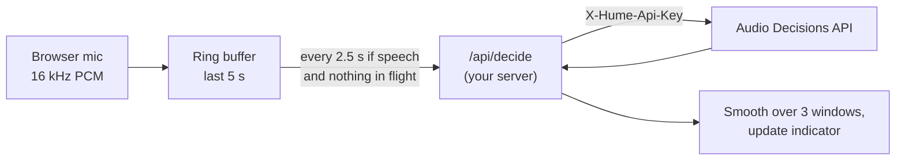

# Example: live answers from the microphone

**Goal:** show, while someone talks, how they sound: a live "calm / tense / upset" indicator.

**Units:** rolling 5 s windows of the microphone, sent every 2.5 s, skipped when the speaker is quiet or a request is still in flight.

**Questions:** one `choice` and one `noul`, the same in every window.

**Shape:** the browser captures audio and sends WAV windows to your own server route, which adds the API key and forwards them. Never put the API key in the browser.



## Server route (Next.js)

```typescript
// app/api/decide/route.ts
const QUESTIONS = {
  state: {
    type: "choice",
    instructions: "Which best describes how the speaker sounds?",
    criteria: [
      { name: "calm", description: "Relaxed and even" },
      { name: "tense", description: "Strained, hurried or on edge" },
      { name: "upset", description: "Clearly frustrated, angry or distressed" },
    ],
  },
  laughing: { type: "noul", instructions: "Does the speaker laugh?" },
};

export async function POST(req: Request) {
  const wav = await req.blob();
  const form = new FormData();
  form.append(
    "request",
    new Blob([JSON.stringify({ context: "One person talking into a laptop microphone.", questions: QUESTIONS })], {
      type: "application/json",
    }),
  );
  form.append("file", wav, "window.wav");

  const res = await fetch("https://api.cloud.hume.ai/v0/decisions/file", {
    method: "POST",
    headers: { "X-Hume-Api-Key": process.env.HUME_API_KEY! },
    body: form,
  });
  return new Response(res.body, { status: res.status, headers: { "Content-Type": "application/json" } });
}
```

## Browser

```typescript
// lib/live-decisions.ts
const RATE = 16000;
const WINDOW_S = 5;
const HOP_MS = 2500;
const SILENCE_RMS = 0.01; // tune on your mic

export async function startLive(onState: (state: string, laughing: boolean) => void) {
  const stream = await navigator.mediaDevices.getUserMedia({ audio: { channelCount: 1 } });
  const ctx = new AudioContext({ sampleRate: RATE });
  const source = ctx.createMediaStreamSource(stream);

  // Ring buffer of the last WINDOW_S seconds.
  const ring = new Float32Array(RATE * WINDOW_S);
  let filled = 0;
  // ScriptProcessorNode is simplest to show; use an AudioWorklet in production.
  const proc = ctx.createScriptProcessor(4096, 1, 1);
  proc.onaudioprocess = (e) => {
    const input = e.inputBuffer.getChannelData(0);
    ring.copyWithin(0, input.length);
    ring.set(input, ring.length - input.length);
    filled = Math.min(ring.length, filled + input.length);
  };
  source.connect(proc);
  proc.connect(ctx.destination);

  const recent: string[] = []; // last few window answers, for smoothing
  let inFlight = false;

  const timer = setInterval(async () => {
    if (inFlight || filled < ring.length) return; // skip, don't queue
    const window = ring.slice();
    if (rms(window) < SILENCE_RMS) return; // don't send silence

    inFlight = true;
    try {
      const res = await fetch("/api/decide", { method: "POST", body: toWav(window, RATE) });
      if (!res.ok) return; // on 429/503, the next hop tries again
      const { answers } = await res.json();
      recent.push(answers.state.choice);
      if (recent.length > 3) recent.shift();
      // Smoothing: only change the indicator when the last 2 of 3 windows agree.
      const counts = recent.reduce<Record<string, number>>((m, s) => ((m[s] = (m[s] ?? 0) + 1), m), {});
      const [top, n] = Object.entries(counts).sort((a, b) => b[1] - a[1])[0];
      if (n >= 2) onState(top, answers.laughing.noul > 0.7); // choose this threshold on your own clips
    } finally {
      inFlight = false;
    }
  }, HOP_MS);

  return () => {
    clearInterval(timer);
    proc.disconnect();
    stream.getTracks().forEach((t) => t.stop());
    ctx.close();
  };
}

function rms(x: Float32Array) {
  let sum = 0;
  for (const v of x) sum += v * v;
  return Math.sqrt(sum / x.length);
}

function toWav(samples: Float32Array, rate: number): Blob {
  const buf = new ArrayBuffer(44 + samples.length * 2);
  const v = new DataView(buf);
  const str = (o: number, s: string) => [...s].forEach((c, i) => v.setUint8(o + i, c.charCodeAt(0)));
  str(0, "RIFF"); v.setUint32(4, 36 + samples.length * 2, true); str(8, "WAVE");
  str(12, "fmt "); v.setUint32(16, 16, true); v.setUint16(20, 1, true); v.setUint16(22, 1, true);
  v.setUint32(24, rate, true); v.setUint32(28, rate * 2, true); v.setUint16(32, 2, true); v.setUint16(34, 16, true);
  str(36, "data"); v.setUint32(40, samples.length * 2, true);
  samples.forEach((s, i) => v.setInt16(44 + i * 2, Math.max(-1, Math.min(1, s)) * 0x7fff, true));
  return new Blob([buf], { type: "audio/wav" });
}
```

## Choices made here, and when to change them

- **5 s windows:** long enough for a judgment about how someone sounds, and the shortest the API accepts: it refuses shorter clips with `audio_too_short`. Lengthen the window if you need to, but don't shorten it.
- **2.5 s hop:** answers refresh twice per window. Measure your round trip first: if it's longer than the hop, requests get skipped. A longer hop costs less.
- **Skip, don't queue:** a queue falls behind and shows stale answers.
- **Silence gate:** saves requests and avoids answers about background noise. When the user mutes or goes quiet, let the indicator relax back to neutral after a few seconds rather than holding the last answer.
- **End-of-turn sending:** in a two-way conversation (a voice agent, a call), send when the speaker pauses instead of on a timer. Each window then holds a whole thought.
- **Smoothing:** 2 of the last 3 windows must agree before the indicator changes. Without it, the indicator flickers.

This shows an answer per window, not continuous monitoring. Say so in your app's copy.
