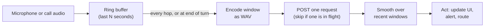

# Choosing the units of audio

A **unit** is the stretch of audio one request covers. The API answers each request on its own, with no memory of earlier requests, so everything an answer depends on has to be inside its unit. The same question can mean different things on different units: "Does the caller sound frustrated?" on one sentence, on a whole turn and on a whole call are three different questions.

## Whose voice

| Recording | Do this |
| --- | --- |
| Stereo, one speaker per channel (most call-center recordings) | Send the channel of the person you're asking about. The API listens to one combined track, so a mixed call lets the other speaker's voice leak into answers about this one. |
| Mono, several speakers | Separate speakers in your own code (diarization) and send each person's turns. If you can't, keep the mix and name the person in the question and in `context` ("the caller", "the agent"). |
| One speaker | Send it as it is. |

Overlapping speech is hard to judge either way. If overlap matters, ask about it directly ("Do two speakers talk at the same time?") on a short window rather than hoping per-speaker answers handle it.

Questions about the conversation itself (interruptions, back-and-forth, who takes the turn) need both voices: send the mixed audio for those.

## How much time

Choose by what you need from the answer.

### Whether something happens in a turn or a call

Ask about the turn, or the whole file. Don't cut it into windows: you only need one answer, and windows multiply requests.

### How a known moment sounds

When you already know where the moment is (the customer's reply to "Do you agree?", the agent's greeting, a line from a script), cut a window **centred on the moment, at least 5 s long**. The API refuses clips shorter than 5 seconds, and a one-word reply lasts a fraction of a second, so pad it with the audio around it rather than sending the word alone.

### Where or how often something happens

You have two patterns.

**Overlapping windows with a `noul` question.** Use this when the event is frequent, or when missing one is costly.

- **Size the window to the event.** A window should be at least twice as long as the longest event you expect, and no shorter than the API's 5 s minimum. Filler words ("um", "uh") are short, so 5 s windows work. Laughter can last several seconds, so use 6–8 s.
- **Overlap the windows** so no event is cut in half everywhere. If the step between window starts (the hop) is no longer than the window length minus the longest event, every event fits whole inside at least one window. Example: 6 s windows every 3 s fully contain any event up to 3 s long. Overlap costs requests: half-overlapping windows double them.
- **Cut at silences where you can,** so window edges fall in pauses rather than mid-word or mid-laugh. Voice activity detection (for example `webrtcvad` or Silero VAD) gives you the pauses.
- **Merge hits.** When neighbouring windows both say yes, treat them as one event unless the gap between them is long enough to be two.

**A `span` question, confirmed with `noul`.** Use this for rare events in long audio, where scanning with windows everywhere would waste requests.

1. Ask the `span` question on the turn or the chunk (up to 5 minutes).
2. For each span returned, cut a window of at least 5 s centred on it and ask a `noul` question about the same event.
3. Keep the spans the `noul` confirms.

Treat spans as candidates, not measurements. Span times are in milliseconds from the start of the file you sent: when you cut the file from a longer recording, or use the SDKs' `create_chunked`, add the cut's or the chunk's `start_ms`. An event that crosses a chunk boundary can come back as two shorter spans, as one that stops at the boundary, or not at all, so merge spans that meet at a boundary.

### An overall impression of a long recording

The API takes up to 5 minutes per request. For longer recordings:

1. Split into chunks of up to 5 minutes. The SDKs' `create_chunked` (`createChunked` in TypeScript) cuts the recording into equal chunks no longer than `max_chunk_ms` and sends them one at a time with the same questions; `iter_create_chunked` does the same but hands you each chunk's answers as they arrive. If you split yourself, split at silences or turn ends rather than every 300 s, so no turn is cut in half, and make sure the last chunk is at least 5 s long.
2. Ask the same questions of every chunk, and write the `context` to hold for any chunk: the model answers each chunk as if it were the whole recording.
3. Combine the answers in your code: the mean for an overall level, the maximum for "did it ever happen", "any chunk above the threshold" for flags. Weight by chunk length when chunks differ a lot.

Each chunk is answered on its own. Say in your results that answers are per chunk and how you combined them. The SDK's chunking details (failures, resuming, MP3 cuts) are in [api-reference.md](api-reference.md#long-recordings).

## Real time

There is no streaming endpoint in the first release. You get live answers by sending short clips of the latest audio as the conversation goes on. Each clip is an ordinary file request.



Decisions to make:

- **Window length.** Long enough to answer on its own: there's no memory between requests. 5 s is the shortest the API accepts and a reasonable start for how someone sounds.
- **Hop (how often you send).** At least the round-trip time of one request, or requests pile up. Measure the round trip in your own setup. If a request is still in flight when the next hop arrives, skip that hop rather than queueing it. Cost and rate-limit use grow with how often you send.
- **Fixed hop or end of turn.** For conversations, sending at the end of each turn (when the speaker pauses) often beats a fixed timer: the window holds a whole thought, and you send fewer requests.
- **Smoothing.** Don't act on one window. Require N windows in a row above the threshold, or use a moving average. Let the state relax back to neutral after a quiet stretch.
- **Silence and mute.** Don't send windows that are mostly silence, and never stitch audio from before and after a mute into one window: the join itself can sound unnatural and trigger wrong answers.
- **Which voice.** In a call, send the far end and the near end separately when you have them as separate streams.

What this gives you is an answer per window. It isn't continuous monitoring, and it doesn't give exact event timing. Say so to users of your app.

## What stays in the audio

- **Silences:** trim them for questions about the speech itself (tone, emotion, accent). Keep them for questions about pace, pauses, hesitation or response timing.
- **Background:** keep it when you're asking about the environment. Don't denoise before asking about recording quality.
- **Re-encoding:** each lossy re-encode can make audio sound more artificial. Send the original where you can, and avoid chains like MP3 → WAV → MP3.

## Preparing audio

The API accepts MP3 and WAV, from 5 seconds to 5 minutes long. It resamples every file to 16 kHz and mixes its channels into one before the model hears it. The SDKs do the same to WAV files before upload, which keeps uploads small, and `downmix_strategy="first_channel"` keeps only the first channel instead (see [api-reference.md](api-reference.md#audio-the-sdks-prepare)). Phone audio (8 kHz) is accepted, but check your questions on your own phone recordings before trusting thresholds.

Useful `ffmpeg` commands:

```bash
# Convert anything to 16 kHz mono WAV
ffmpeg -i in.m4a -ac 1 -ar 16000 out.wav

# Take the left channel (often the caller) of a stereo call
ffmpeg -i call.wav -af "pan=mono|c0=c0" -ar 16000 caller.wav

# Take the right channel
ffmpeg -i call.wav -af "pan=mono|c0=c1" -ar 16000 agent.wav

# Cut a window: 5 seconds starting at 12.5 s
ffmpeg -ss 12.5 -t 5 -i caller.wav -c copy window.wav
```

To split a long recording into chunks, use the SDKs' `create_chunked` rather than a fixed ffmpeg split, which can leave a final chunk shorter than 5 seconds.

Check which channel is which on a few files before processing a batch: the order varies between telephony providers.
