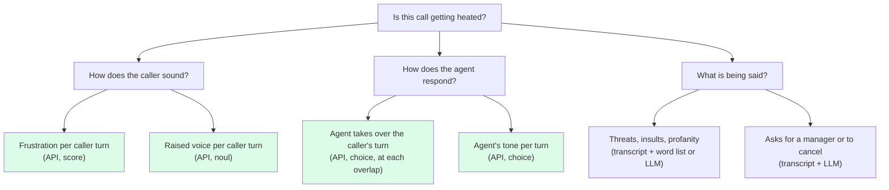

# Breaking down a question the API can't answer in one go

Many real questions aren't listening questions: "Is this call escalating?", "Should this call be reviewed?", "Did the agent handle the complaint well?". They need reasoning, the words, outside data or counting. Don't send them as a single question. Break them into parts, send each part to whatever answers it best, and combine the answers in your code.

## Step 1: Write the root question

Make it concrete:

- **The unit:** per call, per turn, per agent per week?
- **The output:** a flag, a score, a category?
- **The cost of mistakes:** is a missed case worse than a false alarm?
- **How you'll know it's right:** labels from reviewers, a business outcome, a survey?

## Step 2: Break it down until each part has one answerer

Ask: "What would an expert reviewer need to know to answer this?" Each thing they'd need becomes a part. Keep splitting until every part can be answered by exactly one source:

| The part depends on… | Send it to |
| --- | --- |
| How something sounds over a few seconds | The Audio Decisions API |
| Which of several things was said or meant, from a list | The Audio Decisions API (`choice`), or speech-to-text and an LLM |
| The exact words, open-ended content | Speech-to-text and an LLM |
| Counting, exact timing, who spoke when | Diarization, voice activity detection, signal processing |
| Facts outside the audio (account history, order status) | Your own data |

Signs a part isn't small enough yet: it joins two properties with "and"; a listener would have to think it through; it needs the whole call when the evidence is in one moment.

## Step 3: Write how the parts combine

At each level, write the rule in plain terms before coding it. For example: "Flag the call if the caller's frustration is high in two consecutive turns *and* (the agent interrupts at least once *or* the transcript contains a complaint keyword)." Simple rules are easier to check than weighted scores; move to weights only once you have labelled data to fit them.

## Step 4: Check from the bottom up

1. Check each listening part on its own (known-answer clips, a control, two wordings).
2. Check the combined result against your labels.
3. Remove the API's parts and check again. If the result doesn't get worse, the listening parts aren't adding anything yet, and that's worth knowing.

Sometimes the API answers several parts. Sometimes none: if every part depends on the words or on counting, the API isn't the right tool for this question. Say so.

## Example: Is this support call getting heated?

**Root:** per call, flag calls a supervisor should listen to. Missing a heated call is worse than a false alarm. Checked against supervisors' flags on past calls.

Green parts go to the Audio Decisions API; the rest go to a transcript and an LLM. Overlaps come from diarization or from comparing the two channels.

**Combine:** flag when the caller's frustration score is at "Very" or above in two consecutive turns, or when a raised voice and an insult co-occur in one turn, or when the agent takes over the caller's turn twice or more while the caller is frustrated.

**Check:** run on 100 past calls with supervisor flags, tune the thresholds on half and test on the other half. Then remove the green parts and compare.

The full code for this pattern is in [../examples/call-escalation.md](../examples/call-escalation.md).

## Example: Profanity

**Root:** per clip, does it contain a word from our list, and was it directed at someone?

- **Whether a listed word was said:** speech-to-text plus a word list. This is a question about the words, so the transcript is the right tool.
- **How it was said:** the API, on a window around each match: "Is the speaker shouting?" (`noul`), "Which best describes the delivery? Casual / Joking / Angry" (`choice`).
- **Directed at someone:** an LLM reading the transcript around the match.

Here the API adds the delivery, which the transcript can't give you. It doesn't find the words.

## Example: Did the agent handle the complaint well?

This is mostly about the words and the outcome: whether the agent acknowledged the problem, offered a fix and followed policy. Those parts go to a transcript and an LLM judge. The API can add how the agent sounded while doing it (patient, warm, rushed) and whether they talked over the caller. Combine both. Don't expect the API to judge the content of the resolution.
